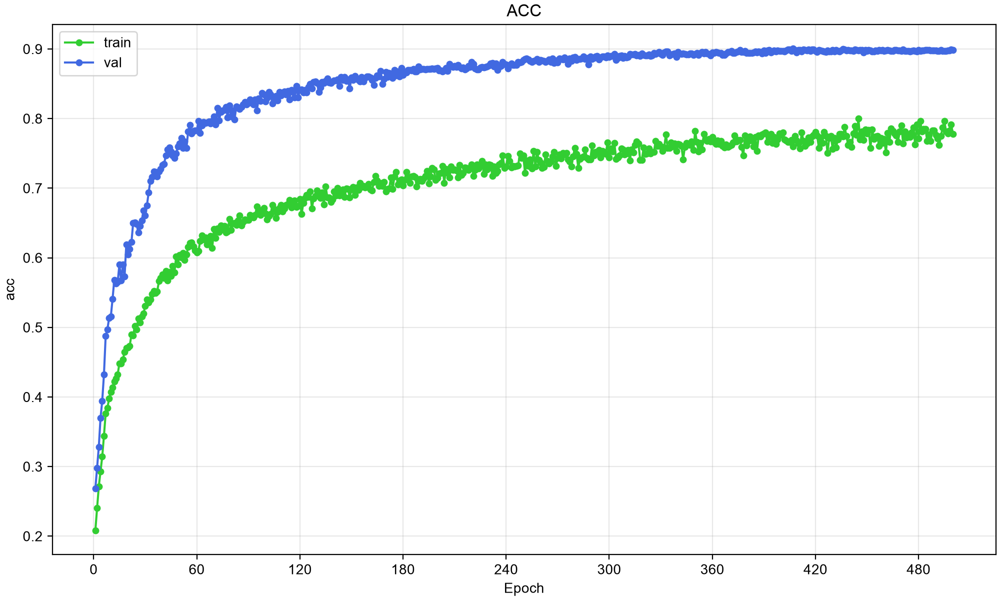
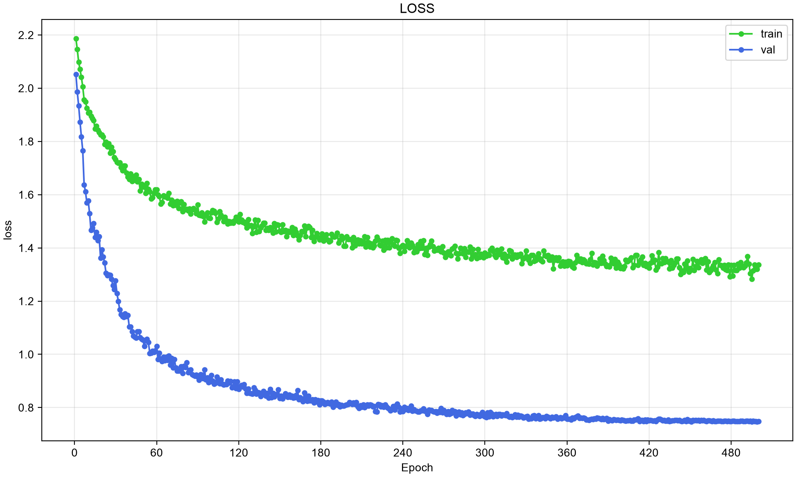

# Vision Transformers CIFAR

## Installation

Requires Python **3.13 or newer**. This project uses [uv](https://docs.astral.sh/uv/) to manage dependencies and run scripts.

Install the dependencies from the repository root:

```bash
uv sync
```

To install without development dependencies:

```bash
uv sync --no-dev
```

## About

A small PyTorch and Lightning project for training Vision Transformers from scratch on **CIFAR-10**. A compact model with **0.81M parameters** achieves a best accuracy of **90.04%** using AugMix, MixUp, CutMix and label smoothing.

The model, Lightning module and data pipeline are separate, with Pydantic models for run configuration. Training includes CSV and TensorBoard logging, model summaries, Rich progress bars, best and last checkpoints, and metric plots updated after each completed epoch.

## Results

Two selected runs trained from scratch on **CIFAR-10**, each with **811,146 parameters** and seed 42. Training uses 50,000 images; the official 10,000-image test split is used for validation and checkpoint selection (`val_acc`).

| Run | Epochs | Best accuracy |
| --- | --- | --- |
| Standard (crop + flip) | 500 | 83.36% |
| AugMix + MixUp/CutMix + label smoothing | 500 | **90.04%** |

Standard overfits: it ends at 99.51% train accuracy and 82.86% validation accuracy, with validation loss still rising. With AugMix, accuracy levels off around 90%, though validation loss is still slowly dropping at 500 epochs, so a longer run might help.

### Standard

Random crop, horizontal flip and normalization, with MixUp, CutMix and label smoothing disabled.

[Config](docs/vit-0.8M_cifar10_standard_e-500/config.json) · [Initialization log](docs/vit-0.8M_cifar10_standard_e-500/logs.log)

### AugMix + MixUp/CutMix

Standard transforms with AugMix, batch MixUp/CutMix and label smoothing 0.1.

[Config](docs/vit-0.8M_cifar10_augmix_e-500/config.json) · [Initialization log](docs/vit-0.8M_cifar10_augmix_e-500/logs.log)

| Accuracy | Loss |
| --- | --- |
|  |  |

With MixUp/CutMix, training accuracy uses the most probable class of each mixed target; validation uses unmixed images.

### Model configuration

| Parameter | Value |
| --- | --- |
| Parameters | 811,146 (0.81M) |
| Input size | 3 × 32 × 32 |
| Patch size | 4 × 4 |
| Embedding dimension | 128 |
| MLP hidden dimension | 256 |
| Transformer blocks | 6 |
| Attention heads | 4 |
| Dropout | 0.1 |

### Training hyperparameters

Settings for the 500-epoch AugMix run.

| Parameter | Value                                                                             |
| -- |-----------------------------------------------------------------------------------|
| Epochs | 500                                                                               |
| Batch size | 128                                                                               |
| Optimizer | AdamW                                                                             |
| LR | 0.0005                                                                            |
| Weight decay | 0.001                                                                             |
| LR scheduler | OneCycleLR, cosine annealing                                                      |
| Loss | Cross-entropy                                                                     |
| Label smoothing | 0.1                                                                               |
| Image augmentation | random crop, horizontal flip, AugMix, CutMix, MixUp                        |

## Usage

Run training from the repository root:

```bash
uv run python scripts/training/train_vit.py
```

Run settings are defined in `RunConfig` inside [train_vit.py](scripts/training/train_vit.py).

Each run creates a timestamped directory under `runs/` containing:

- `config.json` and `logs.log` — configuration, model details and training logs.
- `csv/metrics.csv` — step and epoch metrics.
- `tensorboard/` — TensorBoard event files.
- `metrics_plots/` — training and validation accuracy and loss curves.
- `checkpoints/` — the best checkpoint selected by `val_acc` and `last.ckpt`.

The `scripts/data/`, `scripts/blocks/` and `scripts/models/` directories contain smaller examples for inspecting datasets, image patches and model components.

## Development

### Dependencies

Install the development dependencies:

```bash
uv sync --group dev
```

Or install a specific dependency group defined in `pyproject.toml`:

```bash
uv sync --group <GROUP_NAME>
```

Add a project dependency:

```bash
uv add <PACKAGE_NAME>
```

Add a development dependency:

```bash
uv add --group dev <PACKAGE_NAME>
```

### Versioning

Set the project version:

```bash
uv version <VERSION>
```

Or increment a version component:

```bash
uv version --bump <SEMVER_PART> # e.g. major, minor, patch
```

### Pre-commit

This project uses pre-commit to ensure that the code is formatted correctly.

Install the Git hooks:

```bash
uv run pre-commit install
```

Run pre-commit on all files:

```bash
uv run pre-commit run --all-files
```
